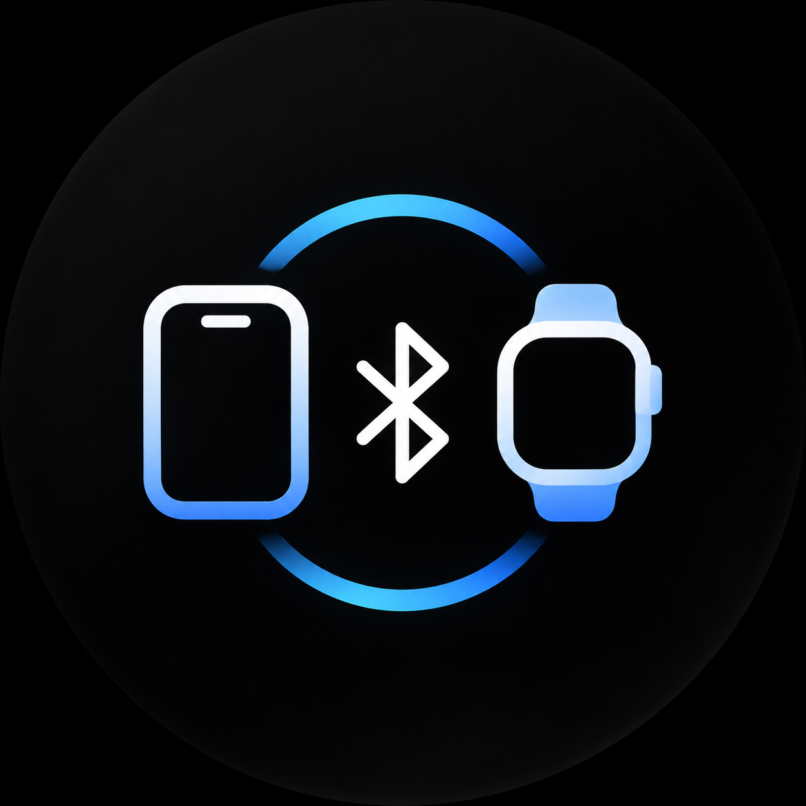

<div align="center">
  
  <h1>WeakBridge</h1>
  <p>Your iPhone notifications and music controls. On your Galaxy Watch.</p>
  <p><a href="https://github.com/Weakmafaka/WeakBridge/releases/latest">Download APK</a> · <a href="docs/README.ru.md">Русский</a> · <a href="https://github.com/Weakmafaka/WeakBridge/issues">Report a bug</a></p>
  <p>  </p>
</div>

WeakBridge connects an already configured Galaxy Watch to an iPhone over Bluetooth. It brings iPhone notifications to the watch and exposes music controls through a native Android media session. No iPhone app, account or cloud service is required. Music continues playing on your iPhone or its selected audio output.

## What works

- Mirror new iPhone notifications, including updates, dismissals and supported actions.
- View track information and control play/pause, next/previous and relative volume.
- Keep the bridge running after closing its screen, with bounded reconnect attempts.
- Filter notification categories and turn music integration on or off.

The project uses Apple's **ANCS** and **AMS** Bluetooth services. It does not replace Galaxy Wearable, set up a factory-reset watch, stream audio, sync health data or add arbitrary message replies.

## Compatibility

**Beta, tested with Galaxy Watch6 (SM-R930) and iPhone 13 running iOS 26.0.** Pairing and music control have been confirmed in use. Other watch models, firmware versions and music apps need testing. Long-term battery consumption has not been measured.

Requires Android 13 / API 33 or later on the watch. Samsung's player UI and gesture behavior depend on the watch firmware. Double pinch in AOD and global fist-to-pause are not provided by WeakBridge.

## Install

1. Download `WeakBridge-0.1.4.apk` from [Releases](https://github.com/Weakmafaka/WeakBridge/releases/latest).
2. Enable Developer options and Wireless debugging on the watch. Connect the watch and computer to the same Wi-Fi network.
3. Use the addresses and ports shown on the watch:

```sh
adb pair WATCH_IP:PAIRING_PORT
adb connect WATCH_IP:DEBUG_PORT
adb install -r WeakBridge-0.1.4.apk
```

The pairing and connection ports are different. Turn Wireless debugging off when finished.

**Upgrading from a private development build:** the public APK uses a dedicated release key. If Android reports `INSTALL_FAILED_UPDATE_INCOMPATIBLE`, uninstall the development version first, then install this APK and select the iPhone again. Uninstalling removes app settings; it does not require deleting the Bluetooth pairing. Future official releases will use the same release key.

## Connect your iPhone

1. Open WeakBridge and allow Nearby devices and notifications.
2. Tap **Подключить iPhone** and approve the system request to make the watch discoverable for two minutes.
3. On iPhone, open **Settings → Bluetooth**, select the watch and confirm pairing on both devices.
4. In WeakBridge, open **Сохранённые устройства** and select your iPhone. Use **Переподключить** to reconnect an already selected device.
5. Allow notification sharing on iPhone. Enable **Share System Notifications** in the watch's Bluetooth entry if the option is shown.
6. Start music or send a new notification to check the connection.

The watch keeps its existing Bluetooth name. The optional ANCS scan is not the main pairing method: an empty scan does not mean the iPhone is incompatible. The current watch interface is primarily in Russian.

## Privacy and battery

Notification content is held in memory and shown through Android notifications. It is not saved as a message history or sent to a server. The app has no Internet permission, analytics or account system. Only settings and the selected Bluetooth device are persisted.

The connection is event-driven: no continuous scan, periodic keepalive or permanent wake lock. Pairing and recovery have time limits. This is a design choice, not a measured battery-life claim. See [power testing](BATTERY_OPTIMIZATION.md).

## Build from source

Use **JDK 17**, **Android SDK 35** and **Build Tools 35.0.0**. Set `ANDROID_HOME` or put your SDK path in `local.properties`.

```sh
./gradlew :app:assembleWear :app:testDebugUnitTest :app:lintWear
```

The optimized local APK is `app/build/outputs/apk/wear/app-wear.apk`. It uses your local development certificate. Debug builds are also available; use the optimized build when evaluating performance.

For a signed release, provide `WEAKBRIDGE_KEYSTORE`, `WEAKBRIDGE_KEY_ALIAS`, `WEAKBRIDGE_STORE_PASSWORD` and `WEAKBRIDGE_KEY_PASSWORD`, then run `./gradlew :app:assembleRelease`. Without those variables, the release output is unsigned. Signing keys are never part of the repository.

## Help improve compatibility

Found a problem? [Open an issue](https://github.com/Weakmafaka/WeakBridge/issues/new/choose) with your watch model, firmware, iOS version and reproduction steps. Remove message text, Bluetooth addresses and other personal details from logs before sharing them.

Pull requests are welcome. Start with [CONTRIBUTING.md](CONTRIBUTING.md), [architecture](ARCHITECTURE.md) and [testing](TESTING.md). If WeakBridge is useful to you, a GitHub star helps others find it.

## License and credits

[MIT](LICENSE). Third-party licenses are listed in [THIRD_PARTY_NOTICES.md](THIRD_PARTY_NOTICES.md). Thanks to the ANCS/AMS community projects linked in [References](docs/RESEARCH.md) for documenting their interoperability findings.
