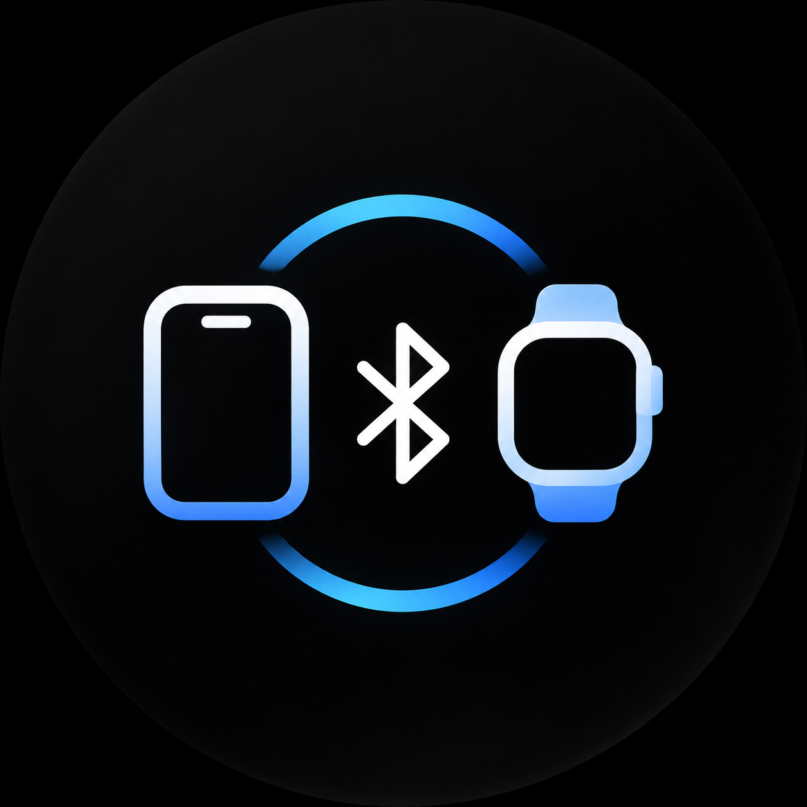

<div align="center">
  
  <h1>WeakBridge</h1>
  <p>Уведомления и управление музыкой с iPhone — на Galaxy Watch.</p>
  <p><a href="https://github.com/Weakmafaka/WeakBridge/releases/latest">Скачать APK</a> · <a href="../README.md">English</a> · <a href="https://github.com/Weakmafaka/WeakBridge/issues">Сообщить об ошибке</a></p>
</div>

WeakBridge связывает уже настроенные Galaxy Watch с iPhone по Bluetooth. Приложение показывает уведомления телефона на часах и передаёт команды управления музыкой. Устанавливать приложение на iPhone, создавать аккаунт или подключать облачный сервис не нужно. Звук остаётся на телефоне или выбранных на нём наушниках.

## Возможности

- Новые уведомления с iPhone, их обновление, удаление и доступные действия.
- Название трека, исполнитель, воспроизведение/пауза, следующий и предыдущий трек, регулировка громкости.
- Фоновая работа и переподключение с ограниченным числом попыток.
- Фильтр категорий уведомлений и отдельное включение управления музыкой.

Это **бета-версия**. Сопряжение и управление музыкой проверены на Galaxy Watch6 SM-R930 с iPhone 13 / iOS 26.0. Работа на других устройствах и прошивках требует проверки. Длительных замеров расхода батареи пока нет.

Часы должны быть уже настроены; WeakBridge не заменяет первоначальную настройку Samsung и Galaxy Wearable. Требуется Android 13 / API 33 или новее. Синхронизации здоровья, передачи звука и произвольных ответов на сообщения нет. Жесты зависят от прошивки: приложение не добавляет двойной щипок в AOD или глобальную паузу сжатием кулака.

## Установка APK

1. Скачайте `WeakBridge-0.1.4.apk` из [последнего релиза](https://github.com/Weakmafaka/WeakBridge/releases/latest).
2. На часах включите параметры разработчика и беспроводную отладку. Подключите часы и компьютер к одной сети Wi-Fi.
3. Выполните команды, подставив адрес и порты с экрана часов:

```sh
adb pair WATCH_IP:PAIRING_PORT
adb connect WATCH_IP:DEBUG_PORT
adb install -r WeakBridge-0.1.4.apk
```

Порт сопряжения и порт подключения отличаются. После установки выключите беспроводную отладку.

**Если раньше стояла приватная тестовая сборка:** публичная версия подписана отдельным ключом. При ошибке `INSTALL_FAILED_UPDATE_INCOMPATIBLE` сначала удалите старое приложение. Его настройки сбросятся; существующее Bluetooth-сопряжение удалять не нужно. После установки снова выберите iPhone. Следующие официальные версии будут подписываться тем же ключом.

## Подключение к iPhone

1. Откройте WeakBridge и разрешите доступ к устройствам поблизости и уведомлениям.
2. Нажмите **«Подключить iPhone»** и подтвердите системный запрос видимости часов на две минуты.
3. На iPhone откройте **Настройки → Bluetooth**, выберите часы и подтвердите сопряжение на обоих устройствах.
4. На часах откройте **«Сохранённые устройства»** и выберите iPhone. Для повторного соединения с уже выбранным телефоном есть кнопка **«Переподключить»**.
5. Разрешите обмен уведомлениями на iPhone. Если в Bluetooth-настройках часов есть пункт **«Делиться системными уведомлениями»**, включите его.
6. Запустите музыку или отправьте новое уведомление.

Название часов в Bluetooth не меняется. «Поиск ANCS» — дополнительный инструмент: iPhone может не появляться в нём даже при рабочем соединении. Основной способ первого подключения — через Bluetooth-настройки iPhone.

## Если что-то не работает

- **Не видно часов:** заново откройте двухминутное окно видимости и подтвердите системный запрос.
- **Разрешения выданы, но сервис недоступен:** проверьте, что выбран именно iPhone, а не другое сохранённое устройство. Разрешение Android и доступ к сервисам iPhone — разные вещи.
- **Нет уведомлений:** проверьте разрешение обмена на iPhone и отправьте новое сообщение. Старые уведомления после подключения намеренно пропускаются.
- **Нет плеера:** начните воспроизведение на iPhone и проверьте настройку «Управление музыкой» в WeakBridge. Поведение системного плеера зависит от прошивки Samsung и приложения на телефоне.

Если проблема повторяется, [создайте issue](https://github.com/Weakmafaka/WeakBridge/issues/new/choose): укажите модели устройств, версии ОС и шаги воспроизведения. Не публикуйте содержимое сообщений и необработанные Bluetooth-журналы.

## Данные и батарея

У приложения нет доступа к Интернету, аналитики и облачного сервера. Тексты уведомлений находятся в оперативной памяти и системных уведомлениях Android; история переписки не сохраняется. На диске остаются настройки и выбранное Bluetooth-устройство.

Постоянного сканирования, опроса телефона и удержания процессора в активном состоянии нет. Фактический расход батареи ещё нужно измерить. [Методика проверки](../BATTERY_OPTIMIZATION.md).

## Разработка

Инструкция сборки — в [основном README](../README.md#build-from-source). Для сборки нужны JDK 17, Android SDK 35 и Build Tools 35.0.0. Лицензия проекта — [MIT](../LICENSE).

Если приложение оказалось полезным, поставьте звезду репозиторию — так его проще найти другим владельцам часов.
